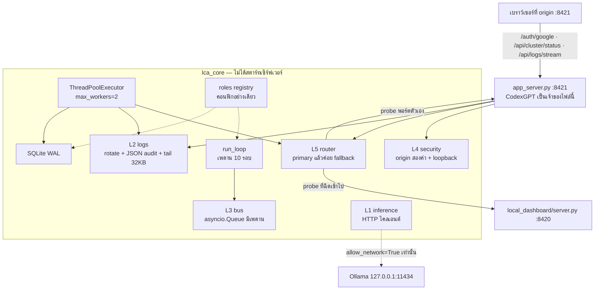

# lca_core — ชิ้นส่วนที่เกตเวย์แดชบอร์ดเรียกใช้

แพ็กเกจ `lca_core/` เป็นไลบรารี Python มาตรฐาน (stdlib) ให้ CodexGPT นำไปประกอบใน `app_server.py` บนเครื่อง Nammon
ไฟล์เกตเวย์นั้นกับ `local_dashboard/server.py` ไม่อยู่ในรีโปนี้ และแพ็กเกจนี้ไม่สร้างมันให้

เครื่องเป้าหมาย: Windows 10, Intel Core i5-7400 (4 คอร์ / 4 เธรด), RAM 8GB, HDD
ขอบเขตเครือข่าย: localhost เท่านั้น

| พอร์ต | บทบาท | โปรเซส |
|---|---|---|
| 8420 | worker | `local_dashboard/server.py` (เครื่อง Nammon) |
| 8421 | dashboard | `app_server.py` เสิร์ฟ `local_dashboard/web/` |
| 11434 | Ollama | ไคลเอนต์อย่างเดียว ไม่ดาวน์โหลดโมเดล |

เส้นที่หน้าเว็บเรียก และที่ `dispatch()` รู้จัก มีสามเส้นนี้เท่านั้น:

- `/auth/google`
- `/api/cluster/status`
- `/api/logs/stream`

`VERSION` ของผลิตภัณฑ์ยังเป็น `0.3.4` แพ็กเกจนี้ไม่มีเลขเวอร์ชันของตัวเอง
ไม่เปิด uvicorn, ไม่ `bind` พอร์ต, และไม่ฟังซ็อกเก็ตตอน import

## แผนผัง



ลูกศรประคือทางที่ปิดไว้จนกว่าเกตเวย์จะเปิดเอง RAG และ MCP ไม่ได้อยู่ในแผนผังนี้ เพราะยังเป็น stub

## ชั้น

| ชั้น | โมดูล | สัญญา |
|---|---|---|
| L5 router | `lca_core.router` | ทะเบียน 8420=worker, 8421=dashboard. ยิง probe ที่ primary `127.0.0.1` ก่อน ถ้าล้มหรือ `down` ค่อยลอง fallback `localhost`. `up` กับ `not_implemented` คือคำตอบสุดท้าย |
| L4 security | `lca_core.security` | origin ต้องตรง `http://localhost:8421` หรือ `http://127.0.0.1:8421` เท่านั้น. ไม่มี `*` |
| L3 queue | `lca_core.bus` | pub/sub ในโปรเซส. คิวละ `maxsize` (ค่าเริ่ม 32). รับแรงดันด้วย `drop-oldest` หรือ `reject` |
| L2 logging | `lca_core.logs` | `RotatingFileHandler` เพดาน 256KiB สำรอง 2 ไฟล์, audit เป็น JSON รายบรรทัด, ตัวนับ error, อ่านหางไฟล์ทีละไม่เกิน 32KB |
| L1 inference | `lca_core.inference` | `POST /api/chat` ที่ loopback. สตรีมทีละไม่เกิน 32KB. ต่อไม่ติดได้สถานะ `ollama offline`. `pull()` โยน `RuntimeError` |
| storage | `lca_core.storage` | `journal_mode=WAL`, `synchronous=NORMAL`, `busy_timeout`. เก็บชื่อไฟล์ที่แพ็กเกจสร้างเอง. `cleanup_stale` ค่าเริ่มคือ dry-run |
| executor | `lca_core.executor` | พูลเดียว 2 เธรด สร้างเมื่อเรียกใช้. `GcHook` ไม่สร้างเธรด และค่าเริ่มปิดอยู่ |
| agent loop | `lca_core.loop` | `observe → reason → act → check`. หยุดเพราะ `goal`, `max_laps`, `token_budget`, หรือ `hard_stop` |
| roles | `lca_core.roles` | แมปชื่อบทบาทไปที่โมดูล. `network` เป็นเท็จทุกแถว |
| routes | `lca_core.routes` | `dispatch()` คืน dict ให้เกตเวย์เขียนลงซ็อกเก็ตเอง |
| stubs | `lca_core.stubs` | `RagIndex` และ `McpEndpoint` โยน `NotImplementedError` |

เทมเพลตในลูปสั้นทั้งสี่บรรทัด: `obs:{n}`, `next:{n}`, `do:{n}`, `done?`

## งบหน่วยความจำ

เครื่องนี้มี RAM 8GB และดิสก์หมุน อย่าเพิ่มพูล อย่าโหลดดัชนีเวกเตอร์ อย่าเปิดโปรเซส MCP

| ส่วน | เพดานที่โค้ดล็อกไว้ |
|---|---|
| import `lca_core` | ไบต์โค้ด Python อย่างเดียว ไม่มีน้ำหนักโมเดล ไม่มีเธรด |
| event bus | 32 เหตุการณ์ต่อคิวของผู้ติดตามหนึ่งราย |
| ไฟล์ล็อก / audit | 256KiB × 3 ไฟล์ (ไฟล์ปัจจุบัน + สำรอง 2) |
| อ่านหางล็อก | หน้าต่างท้ายไฟล์ 256KiB อ่านทีละ 32KB |
| ก้อนที่เขียนออก `/api/logs/stream` | ไม่เกิน 32768 ไบต์ต่อก้อน |
| สตรีม Ollama | อ่านทีละ 32KB. โหมดไม่สตรีมประกอบร่างได้ไม่เกิน 1MiB แล้วตั้ง `truncated` |
| เธรดบล็อก | 2 ไม่มีพารามิเตอร์ขยาย |
| รอบของ `run_loop` | ไม่เกิน 10 แม้ผู้เรียกส่ง `max_laps` สูงกว่านั้น |
| `GcHook` | ปิดจนกว่าผู้เรียกจะตั้ง `enabled=True` แล้วเรียก `maybe_collect` เอง |
| SQLite | ไฟล์ฐานที่ลงทะเบียนไว้ นอก `local_dashboard/web/` |
| RAG / MCP | ไม่จอง RAM และไม่เปิดพอร์ต |

ตัวเลขพวกนี้เป็นเพดานในโค้ด ไม่ใช่การวัด RSS บน Windows ของ Nammon

## บทบาท (คอนฟิกเท่านั้น)

`lca_core.roles.as_config()` คืน dict ที่แปลงเป็น JSON ได้ ไม่มี URL และทุกแถว `"network": false`
ไม่มีฟังก์ชันในโมดูลนี้ที่ติดต่อบอทจริง

| คีย์ | ชื่อ | หน้าที่ | โมดูล |
|---|---|---|---|
| `9arm_manager` | 9arm Manager | orchestrator/governor: เมตริกรอบและ hard stop | `loop`, `executor` |
| `new_bot` | New Bot | ปลั๊กอิน / ส่วนทดลอง | `stubs` |
| `uol_bot` | UOL Bot | เซสชัน + telemetry แบบ SSE | `logs`, `bus`, `routes` |
| `q_botdata` | Q Botdata | SQLite / WAL / ดัชนีในเครื่อง | `storage` |
| `amd_bot` | AMD Bot | พูลเธรด 2 ตัว | `executor` |
| `ulo_bot` | ULO Bot | ไฟล์ในเครื่อง + ความครบของเวิร์กสเปซ | `storage` |
| `moon_bot` | Moon Bot | งานพื้นหลัง, GC, ตรวจสุขภาพตอนว่าง | `executor`, `router` |
| `bot_trading` | Bot trading | ลูปธุรกรรม + บันทึกการทำงานลง audit | `loop`, `logs` |

แถว `bot_trading` บันทึกในเครื่องเท่านั้น ไม่ส่งคำสั่งซื้อและไม่เรียกโบรกเกอร์

## วิธีที่ CodexGPT ต่อเข้า `app_server.py`

วางโค้ดด้านล่างใน `app_server.py` บนเครื่อง Nammon เท่านั้น
อย่าเพิ่มไฟล์นั้นเข้า git อย่ารัน uvicorn และอย่าให้สคริปต์ที่ `start-dashboard.cmd` เรียกไปเปิดพอร์ตจากแพ็กเกจนี้

เกตเวย์ผูก `127.0.0.1:8421` เอง เสิร์ฟไฟล์ใน `local_dashboard/web/` เป็นเว็บรูท
ตรวจสามเส้นนี้ก่อนเสิร์ฟไฟล์สถิต เพื่อให้ `GET /auth/google?code=...` ไม่ตกไปที่ `index.html`
วางฐานข้อมูลไว้นอกโฟลเดอร์นั้น เช่น `%LOCALAPPDATA%\LocalCodeAssistant\data`

```python
import json
import os
from pathlib import Path

from lca_core.executor import get_executor, shutdown_executor
from lca_core.inference import OllamaClient
from lca_core.logs import AuditLog
from lca_core.loop import run_loop
from lca_core.router import tcp_probe
from lca_core.routes import GatewayContext, dispatch
from lca_core.security import cors_config, is_loopback_ip
from lca_core.storage import session

DATA_DIR = Path(os.environ.get("LOCALAPPDATA", ".")) / "LocalCodeAssistant" / "data"
AUDIT_PATH = DATA_DIR / "dashboard-audit.log"

audit = AuditLog(AUDIT_PATH)
ctx = GatewayContext(
    audit_path=AUDIT_PATH,
    probe=tcp_probe,             # เรียกผ่าน executor ด้านล่าง ไม่บล็อกเธรด HTTP
    executor=get_executor(),     # ThreadPoolExecutor(max_workers=2)
    probe_timeout=0.4,
    session={},                  # เกตเวย์เป็นคนใส่ authenticated / name / email
    expected_state=None,         # เก็บ state ตอน mode=start แล้วเอามาเทียบตอน callback
)

# ถ้าภายหลังมี Starlette ให้ส่งค่านี้เข้า CORSMiddleware
# อย่าใส่ "*" — รายการมีแค่สอง origin ของพอร์ต 8421
CORS = cors_config()

# เปิดเน็ตต่อเมื่อเกตเวย์ต้องการคุยกับ Ollama บนเครื่องจริง
# ค่าเริ่มของ OllamaClient คือ allow_network=False จึงตอบ "ollama offline" ทันที
ollama = OllamaClient(allow_network=True, timeout=5.0)


def write_result(handler, result: dict) -> None:
    """เขียนคำตอบที่ dispatch คืนมา. ก้อน SSE ทุกก้อนยาวไม่เกิน 32768 ไบต์"""
    handler.send_response(result["status"])
    for key, value in (result.get("headers") or {}).items():
        handler.send_header(key, value)
    handler.end_headers()
    chunks = result.get("chunks")
    if chunks:
        for chunk in chunks:
            handler.wfile.write(chunk)
        return
    body = result.get("body")
    if body is not None:
        handler.wfile.write(json.dumps(body, ensure_ascii=False).encode("utf-8"))


def handle(handler, method, path, query, accept, origin) -> None:
    peer = handler.client_address[0]
    if not is_loopback_ip(peer):
        handler.send_response(403)
        handler.end_headers()
        return

    # callback: แพ็กเกจตรวจ state ให้ แต่ไม่แลก code กับ Google
    if path == "/auth/google" and method == "GET" and query.get("code"):
        checked = dispatch(method, path, query, ctx=ctx, accept=accept, origin=origin)
        if checked["status"] != 200:
            write_result(handler, checked)
            return
        secret = os.environ.get("GOOGLE_CLIENT_SECRET", "")
        if not secret:
            write_result(handler, {
                "status": 503,
                "headers": {"Content-Type": "application/json; charset=utf-8"},
                "body": {"error": "offline", "detail": "oauth secret missing"},
            })
            return
        # แลก code ที่นี่ด้วย secret จากสภาพแวดล้อม ห้ามเขียน secret ลงรีโป
        # แล้วตั้งคุกกี้ HttpOnly; SameSite=Lax; Path=/ และ 302 ไป /#/account
        profile = exchange_code_on_the_gateway(query["code"], query.get("redirect_uri", ""), secret)
        ctx.session = profile
        handler.send_response(302)
        handler.send_header("Location", "/#/account")
        handler.send_header("Set-Cookie", session_cookie(profile))
        handler.end_headers()
        return

    result = dispatch(method, path, query, ctx=ctx, accept=accept, origin=origin)

    # mode=start: หน้าเว็บรับได้ทั้ง 200 {"url": "..."} และ 302
    # dispatch คืน 200 พร้อม body.url และ location. จะตอบ 302 ก็ได้โดยไม่ให้แพ็กเกจเปิด URL นั้น
    if (
        path == "/auth/google"
        and query.get("mode") == "start"
        and result["status"] == 200
        and result.get("location")
    ):
        ctx.expected_state = result.get("state")
        # ค่าเริ่มส่ง JSON ตาม body. ถ้าต้องการ 302 ให้ใช้ result["location"] แทน
        # และอย่า 302 ตอน mode=status — dispatch ไม่ใส่ location ให้เส้นนั้น

    if path == "/auth/google" and method == "POST" and query.get("mode") == "logout":
        ctx.session = {}
        ctx.expected_state = None

    write_result(handler, result)


def session_cookie(profile: dict) -> str:
    token = profile["session_token"]  # ออกโดยเกตเวย์ ไม่ใช่โดย lca_core
    return f"lca_session={token}; HttpOnly; SameSite=Lax; Path=/"


def exchange_code_on_the_gateway(code: str, redirect_uri: str, secret: str) -> dict:
    """เจ้าของเกตเวย์ทำให้ฟังก์ชันนี้สมบูรณ์บนเครื่อง. แพ็กเกจไม่ยิงไปที่ Google"""
    raise NotImplementedError("exchange the code in app_server.py, not in lca_core")


def on_shutdown() -> None:
    audit.close()
    shutdown_executor(wait=True)
```

`clear_session_cookie()` คืนค่าหัว `Set-Cookie` ที่ลบคุกกี้ (`Max-Age=0`, `SameSite=Lax`)
`dispatch` ใส่หัวนี้ให้ตอน `POST /auth/google?mode=logout` อยู่แล้ว

### รูปร่างที่ `dispatch` คืน

`GET /auth/google?mode=status` เป็น 200 เสมอ ไม่มี `location`

```json
{ "authenticated": false }
```

```json
{ "authenticated": true, "name": "Nammon", "email": "nammon1130@gmail.com" }
```

`GET /auth/google?mode=start` รับ `redirect_uri` เฉพาะสองค่านี้ ไม่งั้น 400

- `http://localhost:8421/auth/google`
- `http://127.0.0.1:8421/auth/google`

ถ้ามี `client_id` ต้องตรงกับ client id สาธารณะใน `lca_core.constants.GOOGLE_CLIENT_ID`
สำเร็จแล้วได้ 200 `{"url": "https://accounts.google.com/o/oauth2/v2/auth?..."}` และฟิลด์ `state` ให้เกตเวย์เก็บ
แพ็กเกจไม่ได้เปิด URL นั้น

`GET /api/cluster/status`

```json
{
  "nodes": [
    { "port": 8420, "role": "worker", "status": "up", "latency_ms": 12 },
    { "port": 8421, "role": "dashboard", "status": "down", "latency_ms": null }
  ]
}
```

`status` เป็น `up`, `down`, หรือ `not_implemented`. ถ้า 8420 ดับ แดชบอร์ดบน 8421 ยังตอบเส้นนี้ได้ และรายงาน 8420 เป็น `down`
probe วิ่งในพูล 2 เธรดเมื่อส่ง `executor` เข้า `GatewayContext`

`GET /api/logs/stream` ค่าเริ่มเป็น SSE

```text
Content-Type: text/event-stream
Cache-Control: no-cache

event: log
data: {"id":1,"ts":"2026-11-10T17:00:00+07:00","level":"info","text":"ready"}
```

`result["chunks"]` คือก้อนที่เขียนลง `wfile` ได้ทีละก้อน แต่ละก้อนยาวไม่เกิน 32768 ไบต์
ส่ง `format=json` หรือ `Accept: application/json` (โดยไม่มี `text/event-stream`) เพื่อได้ snapshot

```json
{ "lines": [ { "id": 1, "ts": "2026-11-10T17:00:00+07:00", "level": "info", "text": "ready" } ] }
```

อ่านไฟล์ล็อกไม่ได้ (เช่น ส่งไดเรกทอรีหรือดิสก์ล็อก) ได้ 503

```json
{ "error": "offline", "detail": "database locked" }
```

เส้นอื่นได้ 404 `{ "error": "not implemented" }`
`OPTIONS` บนสามเส้นนี้ตอบ 204. origin ที่ไม่อยู่ในรายการได้ 403 และไม่มีการสะท้อน origin กลับไป

### SQLite

```python
db_path = DATA_DIR / "lca.db"   # ไม่ใช่ local_dashboard/web/
with session(db_path) as conn:
    conn.execute("CREATE TABLE IF NOT EXISTS events (id INTEGER PRIMARY KEY, text TEXT)")
    conn.commit()
# ออกจากบล็อกแล้วมี wal_checkpoint(TRUNCATE) และลบเฉพาะ *.db.tmp / *.db-journal ที่ลงทะเบียนไว้
```

`cleanup_stale(directory)` ไม่ลบอะไรจนกว่าจะส่ง `dry_run=False`
มันลบเฉพาะชื่อที่ `register()` หรือ `connect()` จำไว้ และเฉพาะไฟล์ที่ลงท้าย `.db.tmp` หรือ `.db-journal`
ไฟล์ชั่วคราวของโปรแกรมอื่นที่ไม่ได้ลงทะเบียนจะไม่ถูกลบ ฐานข้อมูลตัวจริงก็ไม่ถูกลบ
`reclaim_wal(path)` เปิดฐานที่แพ็กเกจนี้สร้างแล้ว checkpoint. ถ้าไม่ใช่ของเราจะคืน `skipped` โดยไม่ไปยุ่งไฟล์

### ลูปของเอเจนต์

`reason` คืน `(action, tokens)` พอเกิน `token_budget` รอบนั้นจะไม่เรียก `act`

```python
def goal_check(output) -> bool:
    return output == "done"

def observe():
    return "screen"

def reason(_observation):
    return ("done", 12)

def act(action):
    audit.write("info", str(action))
    return action

result = run_loop(
    goal_check,
    observe,
    reason,
    act,
    max_laps=10,
    token_budget=800,
    hard_stop=lambda: False,
)
# result.stop_reason ∈ {"goal", "max_laps", "token_budget", "hard_stop"}
# result.laps[i] มี observe_ms, reason_ms, act_ms, tokens, prompt
```

### สิ่งที่ยังไม่ทำในแพ็กเกจนี้

- ไม่แลก OAuth code กับ Google และไม่เก็บ client secret
- ไม่เสิร์ฟไฟล์สถิต และไม่เปิดพอร์ต 8420 หรือ 8421
- ไม่ดาวน์โหลดโมเดล (`OllamaClient.pull` ใช้ไม่ได้)
- ไม่มีฐานเวกเตอร์และไม่มีเซิร์ฟเวอร์ MCP — เรียก `RagIndex` หรือ `McpEndpoint` แล้วจะได้ `NotImplementedError`
- ไม่ติดต่อบอท โบรกเกอร์ หรือเครื่องนอก loopback

## Integration in app_server.py

คัดลอกบล็อกนี้ไปไว้ใน `app_server.py` บนเครื่อง Nammon เท่านั้น อย่า commit ไฟล์นั้น
FastAPI ไม่ได้อยู่ใน `requirements.txt` และเทสของรีโปไม่ได้ import มัน
อย่าเรียก `uvicorn.run` และอย่าให้ `start-dashboard.cmd` เปิด uvicorn
สามเส้นด้านล่างใช้ชื่อ เมธอด และรูปร่าง JSON เดียวกับ `docs/FRONTEND_BACKEND_CONTRACT.md` และ `local_dashboard/web/js/config.js`

- `GET /auth/google?mode=status` → 200 `{"authenticated": false}` หรือ `{"authenticated": true, "name", "email"}` และไม่ 302
- `GET /auth/google?mode=start` → 400 ถ้ายูอาร์ไอไม่ใช่สองค่าที่อนุญาต หรือ 200 `{"url": "https://accounts.google.com/o/oauth2/v2/auth?..."}`
- `GET /auth/google?code=&state=` → เกตเวย์แลก code เอง แล้ว 302 ไป `/#/account` พร้อมคุกกี้ `SameSite=Lax`
- `POST /auth/google?mode=logout` → 200 `{"ok": true}` และลบคุกกี้
- `GET /api/cluster/status` → 200 `{"nodes": [{"port": 8420, "role": "worker", "status", "latency_ms"}, {"port": 8421, "role": "dashboard", ...}]}`
- `GET /api/logs/stream` → `Content-Type: text/event-stream`, `Cache-Control: no-cache`, ก้อนละไม่เกิน 32768 ไบต์, `event: log` / `data: {"id","ts","level","text"}`
- สแนปช็อตที่เส้นเดียวกันเมื่อ `Accept` เป็น `application/json` หรือ `format=json` → 200 `{"lines": [...]}`
- ล็อกใช้ไม่ได้ → 503 `{"error": "offline", "detail": "database locked"}`
- เส้นที่ไม่มี → 404 `{"error": "not implemented"}`
- `OPTIONS` ของสามเส้นนี้ตอบ 204. origin นอกรายการไม่ถูกสะท้อน

```python
import asyncio
import os
from contextlib import asynccontextmanager
from pathlib import Path

from fastapi import FastAPI, Request
from fastapi.middleware.cors import CORSMiddleware
from fastapi.responses import JSONResponse, RedirectResponse, Response, StreamingResponse

from lca_core.executor import GcHook, get_executor, shutdown_executor
from lca_core.logs import AuditLog
from lca_core.router import tcp_probe
from lca_core.routes import GatewayContext, dispatch
from lca_core.security import cors_config
from lca_core.storage import checkpoint_and_close, connect, reclaim_wal

DATA_DIR = Path(os.environ.get("LOCALAPPDATA", ".")) / "LocalCodeAssistant" / "data"
DB_PATH = DATA_DIR / "lca.db"
AUDIT_PATH = DATA_DIR / "dashboard-audit.log"

audit = AuditLog(AUDIT_PATH)
# ThreadPoolExecutor(max_workers=2) — get_executor() สร้างพูลนี้พูลเดียว
executor = get_executor()
gc_hook = GcHook(interval_s=60.0, enabled=True)
ctx = GatewayContext(
    audit_path=AUDIT_PATH,
    probe=tcp_probe,
    executor=executor,
    probe_timeout=0.4,
)


def init_wal(path: Path) -> None:
    # connect() runs: PRAGMA journal_mode=WAL; PRAGMA synchronous=NORMAL;
    path.parent.mkdir(parents=True, exist_ok=True)
    reclaim_wal(path)
    conn = connect(path)
    checkpoint_and_close(conn)


async def _gc_loop() -> None:
    while True:
        await asyncio.sleep(gc_hook.interval_s)
        gc_hook.maybe_collect()


@asynccontextmanager
async def lifespan(_app):
    init_wal(DB_PATH)
    task = asyncio.create_task(_gc_loop())
    try:
        yield
    finally:
        task.cancel()
        audit.close()
        shutdown_executor(wait=True)


app = FastAPI(lifespan=lifespan)
# allow_origins มีแค่ http://localhost:8421 และ http://127.0.0.1:8421
app.add_middleware(CORSMiddleware, **cors_config())


def _query(request: Request) -> dict:
    return {key: value for key, value in request.query_params.multi_items()}


def _reply(result: dict):
    headers = dict(result.get("headers") or {})
    headers.pop("Content-Type", None)
    if result["status"] == 204:
        return Response(status_code=204, headers=headers)
    chunks = result.get("chunks")
    if chunks is not None and result["status"] == 200:
        def generate():
            for chunk in chunks:
                yield chunk
        return StreamingResponse(
            generate(),
            status_code=200,
            media_type="text/event-stream",
            headers=headers,
        )
    if result.get("location") and result["status"] in (301, 302, 303, 307, 308):
        return RedirectResponse(result["location"], status_code=result["status"], headers=headers)
    return JSONResponse(result.get("body"), status_code=result["status"], headers=headers)


@app.api_route("/auth/google", methods=["GET", "POST", "OPTIONS"])
async def auth_google(request: Request):
    query = _query(request)
    accept = request.headers.get("accept", "")
    origin = request.headers.get("origin")
    if request.method == "GET" and query.get("mode") == "status":
        return _reply(dispatch("GET", "/auth/google", query, ctx=ctx, accept=accept, origin=origin))
    if request.method == "GET" and query.get("mode") == "start":
        result = dispatch("GET", "/auth/google", query, ctx=ctx, accept=accept, origin=origin)
        if result["status"] == 200:
            ctx.expected_state = result.get("state")
        return _reply(result)
    if request.method == "GET" and query.get("code"):
        checked = dispatch("GET", "/auth/google", query, ctx=ctx, accept=accept, origin=origin)
        if checked["status"] != 200:
            return _reply(checked)
        return RedirectResponse("/#/account", status_code=302)
    if request.method == "POST" and query.get("mode") == "logout":
        ctx.session = {}
        ctx.expected_state = None
        return _reply(dispatch("POST", "/auth/google", query, ctx=ctx, accept=accept, origin=origin))
    return _reply(dispatch(request.method, "/auth/google", query, ctx=ctx, accept=accept, origin=origin))


@app.api_route("/api/cluster/status", methods=["GET", "OPTIONS"])
async def cluster_status_route(request: Request):
    return _reply(dispatch(
        request.method,
        "/api/cluster/status",
        {},
        ctx=ctx,
        accept=request.headers.get("accept", ""),
        origin=request.headers.get("origin"),
    ))


@app.api_route("/api/logs/stream", methods=["GET", "OPTIONS"])
async def logs_stream(request: Request):
    return _reply(dispatch(
        request.method,
        "/api/logs/stream",
        _query(request),
        ctx=ctx,
        accept=request.headers.get("accept", "") or "text/event-stream",
        origin=request.headers.get("origin"),
    ))
```

## เทส

```bash
python3 -m pytest tests/test_lca_core.py tests/test_lca_dashboard_contract.py tests/test_db.py -q
python3 -m unittest discover -s tests -q
```

เทสใช้ probe, transport, และ `socket.create_connection` แบบจำลอง
`OllamaClient()` ค่าเริ่มไม่เรียก `urlopen`
ไม่มีเคสไหนเปิดเซิร์ฟเวอร์หรือปล่อยพอร์ตค้าง
