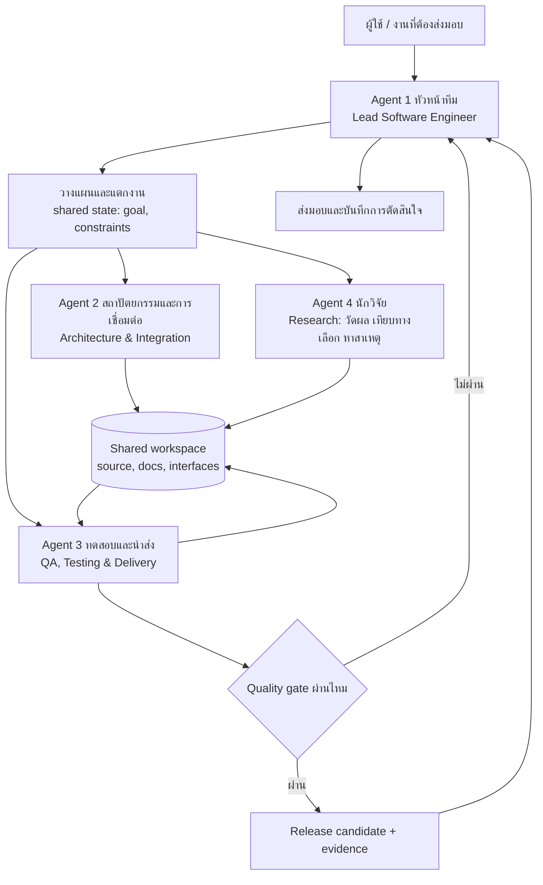
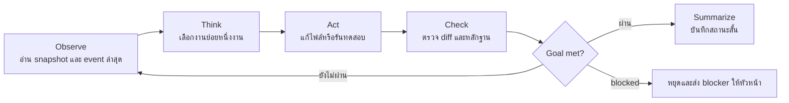

# Software Engineer Agent Map

ทีมนี้ประกอบด้วย Software Engineer 3 Agent และนักวิจัย 1 Agent ที่ทำงานเป็นวงจรเดียวกัน หัวหน้าคุมเป้าหมายและการตัดสินใจ Agent อื่นรับผิดชอบงานเฉพาะด้านและส่งหลักฐานกลับเข้าจุดตรวจร่วม

ใช้กับ repo LCA (`Ragam111/9nammon`) สถานะงานจริงอยู่ใน `docs/LCA_SPEC.md`



## Agent work loop

Agent ทุกตัวทำงานเป็นลูปที่มีเป้าหมายและเงื่อนไขหยุดชัดเจน หัวหน้าเป็นผู้ควบคุมลูปรวม ส่วน Agent 2 และ Agent 3 ทำลูปย่อยเฉพาะงานที่ได้รับมอบหมาย



กติกาของแต่ละรอบคืออ่านเฉพาะ delta ล่าสุด เลือกหนึ่ง action ทำให้เสร็จ ตรวจผลทันที แล้วเขียน event ใหม่ก่อนเริ่มรอบถัดไป ลูปต้องหยุดเมื่อบรรลุ acceptance criteria, พบ blocker ที่แก้เองไม่ได้, ใช้ครบงบประมาณเวลา/Token หรือถึงจำนวนรอบสูงสุดที่หัวหน้ากำหนด ห้ามวนซ้ำโดยไม่มีไฟล์ ผลทดสอบ หรือสถานะใหม่

## บทบาทและขอบเขต

| Agent | หน้าที่หลัก | รับเข้า | ส่งออก | สิทธิ์ตัดสินใจ |
|---|---|---|---|---|
| Agent 1 | หัวหน้าทีม วางแผน จัดลำดับงาน รวมผล และอนุมัติการส่งมอบ | เป้าหมาย ข้อจำกัด รายงานจาก Agent 2 และ 3 | แผนงาน สัญญา interface decision log release decision | ยอมรับขอบเขตและตัดสินใจเมื่อข้อมูลขัดแย้ง |
| Agent 2 | ออกแบบสถาปัตยกรรม API/CLI และการเชื่อมระบบ | แผนงานและข้อกำหนด | architecture note, dependency map, interface checks | เสนอแบบและระบุความเสี่ยงเชิงเทคนิค |
| Agent 3 | ทดสอบ แก้ regression ตรวจคุณภาพ และเตรียมนำส่ง | artifact จาก Agent 2 และ source ใน workspace | test report, failure evidence, release checklist | หยุดการส่งมอบเมื่อ quality gate ไม่ผ่าน |
| Agent 4 | นักวิจัย: วัดผลจริงบนเครื่อง (RAM, latency, คุณภาพโมเดล), เทียบทางเลือก, หาสาเหตุราก ไม่แก้โค้ด | คำถามจากหัวหน้า, log, ผลเทสต์ | research note พร้อมตัวเลขและแหล่งอ้างอิง, ข้อเสนอแผน A/B | เสนอทางเลือกพร้อมหลักฐาน ไม่ตัดสินแทนหัวหน้า |

## โปรโตคอลส่งต่องาน

1. Agent 1 เขียน `goal`, `acceptance criteria`, `constraints` และแบ่งงานเป็นหน่วยเล็กที่ตรวจได้
2. Agent 2 ตรวจ dependency และ interface ก่อนแก้โค้ด เมื่อพบความกำกวมให้ส่งคำถามกลับ Agent 1 พร้อมทางเลือก
3. Agent 3 รันทดสอบจาก artifact ที่อยู่ใน workspace เดียวกัน เก็บคำสั่ง รุ่น runtime และผลลัพธ์ทุกครั้ง
4. Agent 3 ส่งสถานะ `PASS`, `FAIL` หรือ `BLOCKED` พร้อมหลักฐาน ถ้า `FAIL` ต้องระบุขั้นตอนทำซ้ำและไฟล์ที่เกี่ยวข้อง
5. Agent 1 รวมผล ตรวจ acceptance criteria และออก `release decision` พร้อมรายการงานค้าง

## Continuous repo workflow และการประหยัด Token

ไฟล์นี้เป็นเอกสารหลักของทีมและต้องอัปเดตในทุกงานที่มีการเปลี่ยนแปลงบทบาท กระบวนการ หรือสถานะ หัวหน้าอ่านเอกสารนี้ก่อนเริ่มงาน แล้วอ่าน repo แบบ incremental ตามลำดับต่อไปนี้

1. อ่าน `current_work` และ `repo_snapshot` ล่าสุดก่อน ไม่สแกน repo ทั้งหมดซ้ำ
2. ใช้ manifest ของไฟล์และ hash/เวลาแก้ไขเพื่อหาเฉพาะไฟล์ที่เพิ่ม แก้ หรือลบตั้งแต่ snapshot ก่อน
3. อ่านเฉพาะไฟล์ที่เกี่ยวข้องกับ task และไฟล์ dependency ที่จำเป็นต่อการตัดสินใจ
4. เก็บสรุปสั้นใน `repo_snapshot` เช่น entry points, interfaces, tests, known risks และไฟล์ที่ยังไม่อ่าน
5. เมื่อแก้ไฟล์ ให้บันทึก `changed_files`, `why`, `test_status` และ `next_action` ก่อนส่งต่องาน
6. ห้ามส่งเนื้อหาไฟล์เดิมซ้ำในข้อความระหว่าง Agent ให้ส่ง path, symbol, diff สั้น และหลักฐานที่เปลี่ยนเท่านั้น
7. ถ้าข้อมูลไม่เปลี่ยน ให้ใช้ snapshot เดิมและอ้างอิง path เดิม ไม่อ่านซ้ำเพื่อยืนยันโดยไม่มีเหตุผล

Agent 2 ควรเก็บ cache สามระดับใน `.skillkit/cache/` และเพิ่ม path นี้ใน `.gitignore` ได้แก่ file index ที่มี path/hash/size/language, symbol index ที่มี function/class/export และ evidence cache ที่มี requirement/test กับเลขบรรทัด ทุกหลักฐานต้องระบุ `source_hash` และ `indexed_at` ถ้า hash ไม่ตรงกับไฟล์ปัจจุบันให้ invalidate cache และอ่านใหม่ รวมถึงไฟล์ที่ import หรือ depend ต่อกัน

หัวหน้าแบ่งงานเป็นช่วงเล็กแบบ `inspect → design → implement → verify → summarize` โดยแต่ละช่วงมี owner, input, output และ stop condition เดียว Agent รองรับเฉพาะช่วงของตัวเองและส่งผลกลับเป็น structured summary ไม่ส่ง transcript ยาว

## Current work ledger

อัปเดตส่วนนี้ทุกครั้งที่ทำงานต่อ เพื่อให้ Agent รอบถัดไปเริ่มจากสถานะปัจจุบันได้ทันที

```yaml
last_updated: "2026-11-25T12:40:00Z"
current_goal: "LCA ใช้งานจริงบน PC ผ่านเว็บด้วยโมเดลในเครื่อง (Ollama) และไฟล์ติดตั้ง lcalocalai.exe"
current_phase: verifying
repo_snapshot:
  revision: "branch fix/lca-rounds-1-3-quota-config-models @ 75fe3b1"
  entry_points: ["server.py", "lca_app.py", "start-lca.bat", "lca-desktop.bat", ".github/workflows/build-exe.yml"]
  relevant_files: ["app/model_manager.py", "app/models.html", "app/org_store.py", "app/usage_store.py", "app/chat_hub.py"]
  known_risks: ["RAM 8 GB (ว่าง ~1 GB ตอนวัด)", "Ollama ที่เปิดจาก shell หยุดเอง", "cloud_tunnel เปิดสู่อินเทอร์เน็ตได้ รอเจ้าของตัดสิน"]
  unread_or_unknown: ["apps/backend-frontend ยังไม่ได้เลือกเป็นฐาน UI ใหม่"]
delegation:
  - owner: engineer
    task: "แผน B ข้อ 3: หน้าแชตแสดงสาเหตุเมื่อ Ollama ล่ม พร้อมปุ่มลองใหม่ + ลิงก์ไป /models"
    stop_condition: "เทสต์ใหม่ล้มก่อนแก้และผ่านหลังแก้"
    status: todo
  - owner: qa
    task: "เปิด lcalocalai.exe จริง ตรวจ /api/health, /api/version, /models"
    stop_condition: "PASS/FAIL พร้อมภาพหรือ log"
    status: todo (WINDOWS_UNVERIFIED จนกว่าเจ้าของเปิด exe)
  - owner: research
    task: "วัดเวลาตอบและ RAM ของ qwen2.5-coder 0.5b vs 1.5b บนเครื่องนี้"
    stop_condition: "ตัวเลข 3 ครั้งต่อโมเดล"
    status: todo
changed_files: ["app/model_manager.py", "app/models.html", "server.py", "lca_app.py", ".github/workflows/build-exe.yml", "docs/LCA_SPEC.md"]
test_status: "test_model_manager+test_server_models 13 OK; server/version/bind/lca_app 47 OK; full suite not rerun this round"
next_action: "QA เปิด exe จริง แล้ว engineer ทำแผน B ข้อ 3"
blockers: ["เจ้าของต้องตัดสิน: cloud_tunnel, stream ที่ถูกตัดกลางทาง, ฐาน UI"]
```

สถานะที่ส่งระหว่าง Agent ใช้ event สั้นหนึ่งรายการต่อ task เช่น

```json
{
  "agent": "qa",
  "task_id": "QA-100",
  "phase": "regression",
  "status": "RUNNING",
  "completed": ["targeted tests passed"],
  "next": "continue 100 rounds",
  "blocked_by": null,
  "evidence": ["test-report.jsonl"],
  "timestamp": "YYYY-MM-DDTHH:MM:SSZ"
}
```

หัวหน้าอ่านเฉพาะ event ล่าสุดของแต่ละ Agent และแบ่งงานเป็นหนึ่ง deliverable ต่อช่วงสั้นตามรอบ `สำรวจ repo → ออกแบบ interface → สร้าง test matrix → implement ไฟล์ที่อนุมัติ → regression 100 รอบ → release review` ถ้าไม่มีการเปลี่ยนแปลงให้ส่ง `NO_CHANGE` พร้อม hash ถ้าเกิด blocker ให้หยุดและส่ง reproduction ที่สั้นที่สุด

รูปแบบสถานะ QA ที่ใช้ร่วมกันคือ `[QA][phase][status] detail | next: action` รายงานเต็มเก็บเป็น artifact แล้ว shared state เก็บเพียง phase, status, rounds, platform, changed_files, targeted result, artifact และ next action

หากเริ่ม session ใหม่และ `last_updated` เก่ากว่า snapshot ของ repo ให้ตรวจเฉพาะความต่างก่อน หาก ledger ขัดกับไฟล์จริง ให้หยุดสถานะเป็น `blocked` แจ้งความต่างสั้น ๆ แล้วให้ Agent 1 เป็นผู้ตัดสินใจ

## Shared state ขั้นต่ำ

```yaml
goal: "สิ่งที่ต้องส่งมอบ"
constraints: []
interfaces: []
status: planning | implementing | verifying | released | blocked
decisions: []
evidence: []
owner_by_task: {}
```

## ขอบเขตเครื่องมือ

| เครื่องมือ | ผู้ใช้หลัก | ผลลัพธ์ที่ต้องบันทึก |
|---|---|---|
| RAG Search | Agent 1, Agent 2 | แหล่งอ้างอิง ชื่อไฟล์ และเลขบรรทัด |
| RPA/Data Transfer | Agent 2 | schema คอลัมน์ จำนวนแถว และไฟล์ผลลัพธ์ |
| Test Runner | Agent 3 | คำสั่ง รุ่น runtime และผลต่อรอบ |
| Memory Limiter | Agent 3 | งบ MiB ระบบปฏิบัติการ และข้อผิดพลาด resource |
| Package/Release | Agent 1 หลัง quality gate | รุ่น แพ็กเกจ checksum และคำสั่งติดตั้ง |

Agent 2 และ Agent 3 เสนอการเปลี่ยนแปลงผ่าน shared state เท่านั้น ห้ามเปลี่ยน requirement เอง Agent 1 เป็นผู้อนุมัติ `plan`, `delegate`, `approve` และ `merge` ส่วน Agent 2 ใช้สิทธิ์ `inspect`, `design`, `read-docs`, `propose-change` และ Agent 3 ใช้ `test`, `lint`, `benchmark`, `report`

## Quality gates

- G0 Scope ตรวจคำสั่งและพฤติกรรมให้ตรงกับข้อกำหนด
- G1 Static ตรวจ manifest, syntax และไฟล์ในแพ็กเกจ
- G2 Functional ตรวจ smoke test ทั้งกรณีปกติและผิดพลาด
- G3 Reliability ทดสอบซ้ำ 100/100 รอบ
- G4 Packaging ติดตั้งจาก tarball จริงและเรียกผ่าน entry point ได้
- G5 Release มีรายงานผล รุ่น checksum คำสั่งติดตั้ง และ known limitations

Interface มี input/output และ error behavior ระบุครบ งานหลักมีการทดสอบปกติและกรณีผิดพลาด ไม่มีไฟล์ผลลัพธ์บางส่วนหลังงานล้มเหลว และ Agent 1 ตรวจหลักฐานให้ตรงกับ acceptance criteria ก่อนปล่อย release

เมื่อพบ `FAIL` Agent 3 ต้องส่งรอบที่ล้มเหลว คำสั่ง input, stderr, environment และ artifact ที่เหลือให้ Agent 1 จากนั้น Agent 1 ส่งงานแก้กลับ Agent 2 และให้ Agent 3 รัน targeted test ก่อนเริ่ม 100 รอบใหม่ หากไม่มี Windows runner ให้บันทึกสถานะ `WINDOWS_UNVERIFIED` และห้ามสรุปว่า Windows ผ่านแล้ว

## ลำดับการทำงานแบบสั้น

`รับงาน → แตกงานโดยหัวหน้า → ออกแบบโดย Agent 2 → implement → ตรวจโดย Agent 3 → แก้ไข loop → quality gate → release โดยหัวหน้า`

## Release handoff

สิ่งที่ Agent 1 ต้องรวมก่อนส่งมอบคือแพ็กเกจรุ่นที่จะปล่อย รายงาน `test-report-<version>-<platform>.jsonl` จำนวน passed/failed/skipped, checksum, คำสั่งติดตั้งสำหรับ PowerShell และ Linux และ known limitations สถานะสุดท้ายใช้ `RELEASE_CANDIDATE`, `BLOCKED` หรือ `WINDOWS_UNVERIFIED`


## AI-Driven SDLC: 4 Agent ของ LCA กับจุดตรวจของคน
| ขั้น SDLC | Agent ที่รับผิดชอบ | งานของ Agent | จุดตรวจของคน |
|---|---|---|---|
| Plan | Agent 1 หัวหน้า | คัดงานจาก `docs/LCA_SPEC.md` ให้คะแนนความพร้อม จัดลำดับ | เจ้าของอนุมัติขอบเขต |
| Design | Agent 2 สถาปัตยกรรม | เขียนสเปกสั้น ระบุ dependency และ interface | เจ้าของเห็นชอบแบบเมื่อแตะนโยบาย/ความปลอดภัย |
| Build | Agent 2 | ทำเทสต์ให้ล้มก่อน แก้ให้น้อยที่สุด เปิด PR | — |
| Test (วนจนผ่าน) | Agent 3 QA | รันเทสต์ทั้งชุด พยายามทำให้พัง ส่งกลับถ้าไม่ผ่าน (แก้ได้ไม่เกิน 2 รอบต่อจุด) | — |
| Review | Agent 3 QA | ตรวจ PR รอบแรก, security, ผล CI | เจ้าของอนุมัติ PR |
| Deploy | Agent 1 หัวหน้า | build `lcalocalai.exe` ผ่าน CI, รีสตาร์ตเซิร์ฟเวอร์ LAN | เจ้าของอนุมัติ merge และการปล่อยให้ลูกค้า |
| Operate | Agent 4 นักวิจัย | เฝ้า `/api/health`, RAM, Ollama, วัดเวลาตอบ แล้วส่งผลกลับเป็นงานใหม่ใน Plan | เจ้าของรับเรื่อง incident |

ประหยัด token: ทุก Agent อ่าน `docs/LCA_SPEC.md` และ ledger ในไฟล์นี้ก่อน แล้วอ่านเฉพาะไฟล์ที่เปลี่ยนตั้งแต่ commit ล่าสุด (`git diff --stat <commit>..HEAD`) ไม่สแกน repo ทั้งหมดซ้ำ และส่งต่องานเป็นสรุปสั้น (path, ผลเทสต์, ขั้นถัดไป) ไม่ส่งเนื้อหาไฟล์
