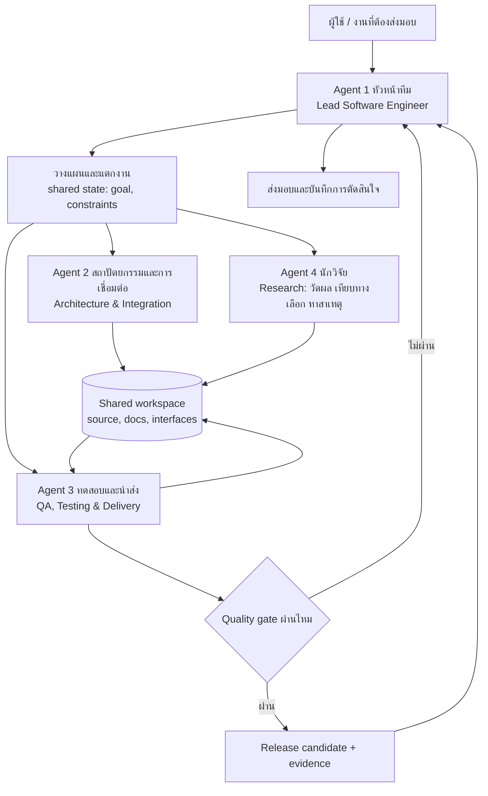
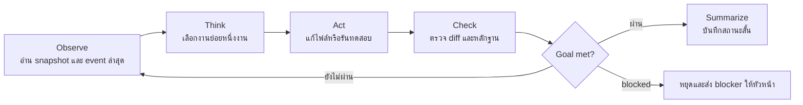

# Software Engineer Agent Map

ทีมนี้ประกอบด้วย Software Engineer 3 Agent และนักวิจัย 1 Agent ที่ทำงานเป็นวงจรเดียวกัน หัวหน้าคุมเป้าหมายและการตัดสินใจ Agent อื่นรับผิดชอบงานเฉพาะด้านและส่งหลักฐานกลับเข้าจุดตรวจร่วม

ใช้กับ repo LCA (`Ragam111/9nammon`) สถานะงานจริงอยู่ใน `docs/LCA_SPEC.md`

> Agent ทั้ง 4 ตัวคือ Claude (Opus) ที่รันเป็น subagent ของ Claude Code ไม่ได้ใช้ Ollama Ollama เป็นแค่โมเดลในเครื่องที่แอป LCA ใช้ตอบลูกค้า ทีม Agent ใช้โควตาของ Claude จึงต้องประหยัด token



## Agent work loop

Agent ทุกตัวทำงานเป็นลูปที่มีเป้าหมายและเงื่อนไขหยุดชัดเจน หัวหน้าเป็นผู้ควบคุมลูปรวม ส่วน Agent 2 และ Agent 3 ทำลูปย่อยเฉพาะงานที่ได้รับมอบหมาย



กติกาของแต่ละรอบคืออ่านเฉพาะ delta ล่าสุด เลือกหนึ่ง action ทำให้เสร็จ ตรวจผลทันที แล้วเขียน event ใหม่ก่อนเริ่มรอบถัดไป ลูปต้องหยุดเมื่อบรรลุ acceptance criteria, พบ blocker ที่แก้เองไม่ได้, ใช้ครบงบประมาณเวลา/Token หรือถึงจำนวนรอบสูงสุดที่หัวหน้ากำหนด ห้ามวนซ้ำโดยไม่มีไฟล์ ผลทดสอบ หรือสถานะใหม่

## บทบาทและขอบเขต

| Agent | หน้าที่หลัก | รับเข้า | ส่งออก | สิทธิ์ตัดสินใจ |
|---|---|---|---|---|
| Agent 1 | หัวหน้าทีม วางแผน จัดลำดับงาน รวมผล และอนุมัติการส่งมอบ | เป้าหมาย ข้อจำกัด รายงานจาก Agent 2 และ 3 | แผนงาน สัญญา interface decision log release decision | ยอมรับขอบเขตและตัดสินใจเมื่อข้อมูลขัดแย้ง |
| Agent 2 | ออกแบบสถาปัตยกรรม API/CLI และการเชื่อมระบบ | แผนงานและข้อกำหนด | architecture note, dependency map, interface checks | เสนอแบบและระบุความเสี่ยงเชิงเทคนิค |
| Agent 3 | ทดสอบ แก้ regression ตรวจคุณภาพ และเตรียมนำส่ง | artifact จาก Agent 2 และ source ใน workspace | test report, failure evidence, release checklist | หยุดการส่งมอบเมื่อ quality gate ไม่ผ่าน |
| Agent 4 | นักวิจัย: วัดผลจริงบนเครื่อง (RAM, latency, คุณภาพโมเดล), เทียบทางเลือก, หาสาเหตุราก ไม่แก้โค้ด | คำถามจากหัวหน้า, log, ผลเทสต์ | research note พร้อมตัวเลขและแหล่งอ้างอิง, ข้อเสนอแผน A/B | เสนอทางเลือกพร้อมหลักฐาน ไม่ตัดสินแทนหัวหน้า |

## โปรโตคอลส่งต่องาน

1. Agent 1 เขียน `goal`, `acceptance criteria`, `constraints` และแบ่งงานเป็นหน่วยเล็กที่ตรวจได้
2. Agent 2 ตรวจ dependency และ interface ก่อนแก้โค้ด เมื่อพบความกำกวมให้ส่งคำถามกลับ Agent 1 พร้อมทางเลือก
3. Agent 3 รันทดสอบจาก artifact ที่อยู่ใน workspace เดียวกัน เก็บคำสั่ง รุ่น runtime และผลลัพธ์ทุกครั้ง
4. Agent 3 ส่งสถานะ `PASS`, `FAIL` หรือ `BLOCKED` พร้อมหลักฐาน ถ้า `FAIL` ต้องระบุขั้นตอนทำซ้ำและไฟล์ที่เกี่ยวข้อง
5. Agent 1 รวมผล ตรวจ acceptance criteria และออก `release decision` พร้อมรายการงานค้าง

## Continuous repo workflow และการประหยัด Token

ไฟล์นี้เป็นเอกสารหลักของทีมและต้องอัปเดตในทุกงานที่มีการเปลี่ยนแปลงบทบาท กระบวนการ หรือสถานะ หัวหน้าอ่านเอกสารนี้ก่อนเริ่มงาน แล้วอ่าน repo แบบ incremental ตามลำดับต่อไปนี้

1. อ่าน `current_work` และ `repo_snapshot` ล่าสุดก่อน ไม่สแกน repo ทั้งหมดซ้ำ
2. ใช้ manifest ของไฟล์และ hash/เวลาแก้ไขเพื่อหาเฉพาะไฟล์ที่เพิ่ม แก้ หรือลบตั้งแต่ snapshot ก่อน
3. อ่านเฉพาะไฟล์ที่เกี่ยวข้องกับ task และไฟล์ dependency ที่จำเป็นต่อการตัดสินใจ
4. เก็บสรุปสั้นใน `repo_snapshot` เช่น entry points, interfaces, tests, known risks และไฟล์ที่ยังไม่อ่าน
5. เมื่อแก้ไฟล์ ให้บันทึก `changed_files`, `why`, `test_status` และ `next_action` ก่อนส่งต่องาน
6. ห้ามส่งเนื้อหาไฟล์เดิมซ้ำในข้อความระหว่าง Agent ให้ส่ง path, symbol, diff สั้น และหลักฐานที่เปลี่ยนเท่านั้น
7. ถ้าข้อมูลไม่เปลี่ยน ให้ใช้ snapshot เดิมและอ้างอิง path เดิม ไม่อ่านซ้ำเพื่อยืนยันโดยไม่มีเหตุผล

Agent 2 ควรเก็บ cache สามระดับใน `.skillkit/cache/` และเพิ่ม path นี้ใน `.gitignore` ได้แก่ file index ที่มี path/hash/size/language, symbol index ที่มี function/class/export และ evidence cache ที่มี requirement/test กับเลขบรรทัด ทุกหลักฐานต้องระบุ `source_hash` และ `indexed_at` ถ้า hash ไม่ตรงกับไฟล์ปัจจุบันให้ invalidate cache และอ่านใหม่ รวมถึงไฟล์ที่ import หรือ depend ต่อกัน

หัวหน้าแบ่งงานเป็นช่วงเล็กแบบ `inspect → design → implement → verify → summarize` โดยแต่ละช่วงมี owner, input, output และ stop condition เดียว Agent รองรับเฉพาะช่วงของตัวเองและส่งผลกลับเป็น structured summary ไม่ส่ง transcript ยาว

## Current work ledger

อัปเดตส่วนนี้ทุกครั้งที่ทำงานต่อ เพื่อให้ Agent รอบถัดไปเริ่มจากสถานะปัจจุบันได้ทันที

```yaml
last_updated: "2026-11-25T12:40:00Z"
current_goal: "LCA ใช้งานจริงบน PC ผ่านเว็บด้วยโมเดลในเครื่อง (Ollama) และไฟล์ติดตั้ง lcalocalai.exe"
current_phase: verifying
repo_snapshot:
  revision: "branch fix/lca-rounds-1-3-quota-config-models @ 75fe3b1"
  entry_points: ["server.py", "lca_app.py", "start-lca.bat", "lca-desktop.bat", ".github/workflows/build-exe.yml"]
  relevant_files: ["app/model_manager.py", "app/models.html", "app/org_store.py", "app/usage_store.py", "app/chat_hub.py"]
  known_risks: ["RAM 8 GB (ว่าง ~1 GB ตอนวัด)", "Ollama ที่เปิดจาก shell หยุดเอง", "cloud_tunnel เปิดสู่อินเทอร์เน็ตได้ รอเจ้าของตัดสิน"]
  unread_or_unknown: ["apps/backend-frontend ยังไม่ได้เลือกเป็นฐาน UI ใหม่"]
delegation:
  - owner: engineer
    task: "แผน B ข้อ 3: หน้าแชตแสดงสาเหตุเมื่อ Ollama ล่ม พร้อมปุ่มลองใหม่ + ลิงก์ไป /models"
    stop_condition: "เทสต์ใหม่ล้มก่อนแก้และผ่านหลังแก้"
    status: todo
  - owner: qa
    task: "เปิด lcalocalai.exe จริง ตรวจ /api/health, /api/version, /models"
    stop_condition: "PASS/FAIL พร้อมภาพหรือ log"
    status: todo (WINDOWS_UNVERIFIED จนกว่าเจ้าของเปิด exe)
  - owner: research
    task: "วัดเวลาตอบและ RAM ของ qwen2.5-coder 0.5b vs 1.5b บนเครื่องนี้"
    stop_condition: "ตัวเลข 3 ครั้งต่อโมเดล"
    status: todo
changed_files: ["app/model_manager.py", "app/models.html", "server.py", "lca_app.py", ".github/workflows/build-exe.yml", "docs/LCA_SPEC.md"]
test_status: "test_model_manager+test_server_models 13 OK; server/version/bind/lca_app 47 OK; full suite not rerun this round"
next_action: "QA เปิด exe จริง แล้ว engineer ทำแผน B ข้อ 3"
blockers: ["เจ้าของต้องตัดสิน: cloud_tunnel, stream ที่ถูกตัดกลางทาง, ฐาน UI"]
```

สถานะที่ส่งระหว่าง Agent ใช้ event สั้นหนึ่งรายการต่อ task เช่น

```json
{
  "agent": "qa",
  "task_id": "QA-100",
  "phase": "regression",
  "status": "RUNNING",
  "completed": ["targeted tests passed"],
  "next": "continue 100 rounds",
  "blocked_by": null,
  "evidence": ["test-report.jsonl"],
  "timestamp": "YYYY-MM-DDTHH:MM:SSZ"
}
```

หัวหน้าอ่านเฉพาะ event ล่าสุดของแต่ละ Agent และแบ่งงานเป็นหนึ่ง deliverable ต่อช่วงสั้นตามรอบ `สำรวจ repo → ออกแบบ interface → สร้าง test matrix → implement ไฟล์ที่อนุมัติ → regression 100 รอบ → release review` ถ้าไม่มีการเปลี่ยนแปลงให้ส่ง `NO_CHANGE` พร้อม hash ถ้าเกิด blocker ให้หยุดและส่ง reproduction ที่สั้นที่สุด

รูปแบบสถานะ QA ที่ใช้ร่วมกันคือ `[QA][phase][status] detail | next: action` รายงานเต็มเก็บเป็น artifact แล้ว shared state เก็บเพียง phase, status, rounds, platform, changed_files, targeted result, artifact และ next action

หากเริ่ม session ใหม่และ `last_updated` เก่ากว่า snapshot ของ repo ให้ตรวจเฉพาะความต่างก่อน หาก ledger ขัดกับไฟล์จริง ให้หยุดสถานะเป็น `blocked` แจ้งความต่างสั้น ๆ แล้วให้ Agent 1 เป็นผู้ตัดสินใจ

## Shared state ขั้นต่ำ

```yaml
goal: "สิ่งที่ต้องส่งมอบ"
constraints: []
interfaces: []
status: planning | implementing | verifying | released | blocked
decisions: []
evidence: []
owner_by_task: {}
```

## ขอบเขตเครื่องมือ

| เครื่องมือ | ผู้ใช้หลัก | ผลลัพธ์ที่ต้องบันทึก |
|---|---|---|
| RAG Search | Agent 1, Agent 2 | แหล่งอ้างอิง ชื่อไฟล์ และเลขบรรทัด |
| RPA/Data Transfer | Agent 2 | schema คอลัมน์ จำนวนแถว และไฟล์ผลลัพธ์ |
| Test Runner | Agent 3 | คำสั่ง รุ่น runtime และผลต่อรอบ |
| Memory Limiter | Agent 3 | งบ MiB ระบบปฏิบัติการ และข้อผิดพลาด resource |
| Package/Release | Agent 1 หลัง quality gate | รุ่น แพ็กเกจ checksum และคำสั่งติดตั้ง |

Agent 2 และ Agent 3 เสนอการเปลี่ยนแปลงผ่าน shared state เท่านั้น ห้ามเปลี่ยน requirement เอง Agent 1 เป็นผู้อนุมัติ `plan`, `delegate`, `approve` และ `merge` ส่วน Agent 2 ใช้สิทธิ์ `inspect`, `design`, `read-docs`, `propose-change` และ Agent 3 ใช้ `test`, `lint`, `benchmark`, `report`

## Quality gates

- G0 Scope ตรวจคำสั่งและพฤติกรรมให้ตรงกับข้อกำหนด
- G1 Static ตรวจ manifest, syntax และไฟล์ในแพ็กเกจ
- G2 Functional ตรวจ smoke test ทั้งกรณีปกติและผิดพลาด
- G3 Reliability ทดสอบซ้ำ 100/100 รอบ
- G4 Packaging ติดตั้งจาก tarball จริงและเรียกผ่าน entry point ได้
- G5 Release มีรายงานผล รุ่น checksum คำสั่งติดตั้ง และ known limitations

Interface มี input/output และ error behavior ระบุครบ งานหลักมีการทดสอบปกติและกรณีผิดพลาด ไม่มีไฟล์ผลลัพธ์บางส่วนหลังงานล้มเหลว และ Agent 1 ตรวจหลักฐานให้ตรงกับ acceptance criteria ก่อนปล่อย release

เมื่อพบ `FAIL` Agent 3 ต้องส่งรอบที่ล้มเหลว คำสั่ง input, stderr, environment และ artifact ที่เหลือให้ Agent 1 จากนั้น Agent 1 ส่งงานแก้กลับ Agent 2 และให้ Agent 3 รัน targeted test ก่อนเริ่ม 100 รอบใหม่ หากไม่มี Windows runner ให้บันทึกสถานะ `WINDOWS_UNVERIFIED` และห้ามสรุปว่า Windows ผ่านแล้ว

## ลำดับการทำงานแบบสั้น

`รับงาน → แตกงานโดยหัวหน้า → ออกแบบโดย Agent 2 → implement → ตรวจโดย Agent 3 → แก้ไข loop → quality gate → release โดยหัวหน้า`

## Release handoff

สิ่งที่ Agent 1 ต้องรวมก่อนส่งมอบคือแพ็กเกจรุ่นที่จะปล่อย รายงาน `test-report-<version>-<platform>.jsonl` จำนวน passed/failed/skipped, checksum, คำสั่งติดตั้งสำหรับ PowerShell และ Linux และ known limitations สถานะสุดท้ายใช้ `RELEASE_CANDIDATE`, `BLOCKED` หรือ `WINDOWS_UNVERIFIED`


## AI-Driven SDLC: 4 Agent ของ LCA กับจุดตรวจของคน
| ขั้น SDLC | Agent ที่รับผิดชอบ | งานของ Agent | จุดตรวจของคน |
|---|---|---|---|
| Plan | Agent 1 หัวหน้า | คัดงานจาก `docs/LCA_SPEC.md` ให้คะแนนความพร้อม จัดลำดับ | เจ้าของอนุมัติขอบเขต |
| Design | Agent 2 สถาปัตยกรรม | เขียนสเปกสั้น ระบุ dependency และ interface | เจ้าของเห็นชอบแบบเมื่อแตะนโยบาย/ความปลอดภัย |
| Build | Agent 2 | ทำเทสต์ให้ล้มก่อน แก้ให้น้อยที่สุด เปิด PR | — |
| Test (วนจนผ่าน) | Agent 3 QA | รันเทสต์ทั้งชุด พยายามทำให้พัง ส่งกลับถ้าไม่ผ่าน (แก้ได้ไม่เกิน 2 รอบต่อจุด) | — |
| Review | Agent 3 QA | ตรวจ PR รอบแรก, security, ผล CI | เจ้าของอนุมัติ PR |
| Deploy | Agent 1 หัวหน้า | build `lcalocalai.exe` ผ่าน CI, รีสตาร์ตเซิร์ฟเวอร์ LAN | เจ้าของอนุมัติ merge และการปล่อยให้ลูกค้า |
| Operate | Agent 4 นักวิจัย | เฝ้า `/api/health`, RAM, Ollama, วัดเวลาตอบ แล้วส่งผลกลับเป็นงานใหม่ใน Plan | เจ้าของรับเรื่อง incident |

ประหยัด token: ทุก Agent อ่าน `docs/LCA_SPEC.md` และ ledger ในไฟล์นี้ก่อน แล้วอ่านเฉพาะไฟล์ที่เปลี่ยนตั้งแต่ commit ล่าสุด (`git diff --stat <commit>..HEAD`) ไม่สแกน repo ทั้งหมดซ้ำ และส่งต่องานเป็นสรุปสั้น (path, ผลเทสต์, ขั้นถัดไป) ไม่ส่งเนื้อหาไฟล์

## ตารางกะของทีม (หัวหน้าเป็นผู้จัด เพื่อประหยัดโควตา Claude)
โควตามี 2 ชั้น: รอบ 5 ชั่วโมง และรายสัปดาห์ (รีเซ็ตวันพุธ 15:00) แต่ละกะใช้ 1 รอบ 5 ชั่วโมง และทำ 1 เป้าหมายเท่านั้น

| กะ | Agent ที่เข้างาน | งาน | หยุดเมื่อ |
|---|---|---|---|
| กะ 0 (ตอนนี้ โควตาสัปดาห์เหลือ ~1–2%) | นักวิจัย + QA → Engineer → QA | 1 รอบ: วัดผล, หาบั๊ก, แก้บั๊กอันดับ 1, ตรวจซ้ำ | จบ 1 รอบ หรือโควตาหมด |
| กะ 1 (หลังรีเซ็ต) | หัวหน้า + นักวิจัย | อ่าน ledger, เลือก 3 งานจาก `LCA_SPEC.md`, วัดสถานะเครื่อง | ได้รายการงาน 3 ข้อพร้อมเกณฑ์ผ่าน |
| กะ 2 | สถาปัตยกรรม (Engineer) | แก้งานข้อ 1–3 ทีละข้อ แบบเทสต์ล้มก่อน | ทำครบหรือแก้ไม่ผ่าน 2 รอบ |
| กะ 3 | QA | รันเทสต์ทั้งชุด ทำให้พัง ตรวจทุกงานของกะ 2 | PASS/FAIL ทุกข้อพร้อมหลักฐาน |
| กะ 4 | หัวหน้า | รวม commit, build `lcalocalai.exe`, อัปเดต ledger, ขอเจ้าของ merge | ledger อัปเดตและ PR พร้อม |

กติกาประหยัด: ไม่เปิด Agent ซ้อนเกิน 2 ตัวในกะเดียว, ส่งต่องานเป็นสรุปสั้น, ถ้าโควตาเหลือน้อยกว่า 10% ให้หยุดหลังจบงานที่ทำอยู่และบันทึก ledger ก่อน

## ผลกะ 0 (2026-11-25, Claude Opus 4 agent, ~422k token)
| Agent | ผล |
|---|---|
| นักวิจัย | RAM ว่าง 0.88/7.88 GiB (ระหว่างรันเหลือ 0.33–0.50). `qwen2.5-coder:0.5b` 22 tok/s, ตอบ 64 token ใน ~3 วินาที (โหลดเย็น 55 วินาที). `1.5b` 10 tok/s, โหลดเย็นครั้งแรก timeout 180 วินาที. แนะนำ: ค่าเริ่มต้น 0.5b บนเครื่องนี้ ใช้ 1.5b เมื่อ RAM ว่างเกิน 2 GB |
| QA | 113 tests, error 5 (2 = ไม่มี `grep` ใน PATH, 2 = timeout ตอน RAM ว่าง 0.42 GB, 1 = ไฟล์ stats.db ถูกล็อกตอน cleanup). บั๊ก 1 major + 4 minor |
| Engineer | แก้ major: `/api/models/pull` เขียน HTTP 500 ซ้อนหลัง stream 200 เมื่อ Ollama หลุดกลางทาง (commit `eabc062`) |
| QA verify | PASS |

บั๊ก minor ที่ค้าง (งานของกะถัดไป):
1. pull ที่ timeout/reset กลาง stream จบเงียบ ไม่มี event error; read timeout 30 วินาทีอาจสั้นไปตอน verify ไฟล์ใหญ่บน HDD
2. `/api/health` และ `/models` เช็ค Ollama ที่ 127.0.0.1 ตายตัว ไม่ตรงกับ `OLLAMA_BASE_URL` ที่แชตใช้
3. `ConnectionAbortedError` (WinError 10053) ไม่ถูกนับเป็น client หลุด จึงลง error log
4. `tests/test_agent_tools.py` ต้องมี `grep` ใน PATH ควร skip เมื่อไม่มี

## ผลกะ 1 (2026-11-25, นักวิจัย + สถาปนิก, ~238k token)
**ความจุ (นักวิจัย):** ผู้ใช้ active ต้องการ ~1.67 tok/s (ตอบ 200 token ทุก 2 นาที) PC เครื่องนี้ด้วย 0.5b (22 tok/s) รับได้ ~9–13 คน active ≈ ผู้ใช้ลงทะเบียน ~100 คน
| ผู้ใช้ลงทะเบียน | PC แบบนี้ที่ต้องใช้ | ทางที่แนะนำ | ค่าใช้จ่าย/เดือน (ประมาณ) |
|---|---|---|---|
| ~100 (เบต้า) | 1 | A: Cloudflare named Tunnel + บังคับ login + rate limit + ตรึง 0.5b | ~$0 + ค่าโดเมน |
| 10,000 | 76 | C: LCA เป็น gateway + API แบบ OpenAI-compatible (เช่น Groq 8B) แล้วค่อยเพิ่ม B: GPU เช่า + vLLM | ~$123 (API) ถึง $250–1,000 (GPU) |
| 1,000,000 | 7,576 | D: GPU fleet autoscale หลาย region + API overflow + ทีม ops | ~$12k–40k ยังไม่รวม ops |
ตัวเลขราคาและ throughput ของ GPU บางส่วนมาจากแหล่งภายนอกที่ยังไม่ได้ยืนยันเอง

**ช่องว่างที่ต้องปิดก่อนเปิดเบต้า (สถาปนิก):** IP จริงหลัง tunnel, rate limit/admission ต่อผู้ใช้, บัญชีและโควตาเก็บใน `org.json` (ช้าและไม่ทนหลายโปรเซส), session อยู่ใน RAM, Google login ยังไม่มี route, โควตายังนับเป็นจำนวน request ไม่ใช่ token, ไม่มี HTTPS ในตัว, ไม่มี audit log

**3 งานของกะ 2 (เรียงตามลำดับ):**
1. (S) IP จริงจาก proxy ที่เชื่อถือได้ (`LCA_TRUST_PROXY=1`) + rate limit ต่อ key/ผู้ใช้ + เพดาน generation ต่อผู้ใช้ + ล้าง key ว่างใน RateLimiter
2. (M) ย้ายผู้ใช้/API key/โควตา/session จาก `org.json` ไป SQLite (WAL) หักโควตาแบบ atomic และ migrate พร้อม backup
3. (M) Google login แบบทดสอบบน localhost (state + PKCE) + โควตาฟรี 1,000,000 token/เดือน นับจากจำนวน token จริง

## แผนสปรินต์ถึงวันอาทิตย์ 2026-11-29
| วัน | งาน | ผู้ทำ | เกณฑ์เสร็จ |
|---|---|---|---|
| พ. 25 | SQLite สำหรับบัญชี/คีย์/โควตา/session (สาขา `wip/sqlite-org-store`) + ทดสอบเจาะระบบรอบใหม่ | Engineer (worktree แยก) + QA security | QA PASS, รายการช่องโหว่พร้อมหลักฐาน |
| พฤ. 26 | แก้ช่องโหว่ระดับ blocker/major ที่ QA เจอ แล้วรวม SQLite เข้าสาขาหลัก | Engineer → QA | เทสต์ทั้งชุดผ่าน |
| ศ. 27 | Google login บน localhost (state + PKCE) + โควตาฟรีนับเป็น token | Engineer → QA | เทสต์กับ fake Google ผ่าน |
| ส. 28 | build `lcalocalai.exe`, รีสตาร์ตเซิร์ฟเวอร์ LAN, วัดผลบนเครื่องจริง | หัวหน้า + นักวิจัย | `/api/health`, `/v1/models`, แชต ผ่านบนเครื่องจริง |
| อา. 29 | เปิด PR รวม, อัปเดต `LCA_SPEC.md` และคู่มือ, ส่งให้เจ้าของ merge | หัวหน้า | PR เขียว CI รอเจ้าของ merge |
สิ่งที่ต้องให้เจ้าของทำ/ตัดสินก่อนวันอาทิตย์: Google OAuth Client (ดู `docs/CREDENTIALS_GUIDE.md`), ตั้ง IP คงที่ที่ router, ตัดสินเรื่อง `cloud_tunnel`

## ผล 2026-11-26 (SQLite + ทดสอบเจาะระบบ)
- SQLite: QA PASS รวมเข้าสาขาหลักแล้ว (`8d44c45`). ต้นเหตุเทสต์ค้าง: ปิด connection ทุกครั้งทำให้ SQLite checkpoint+fsync ~90 ms ต่อการเขียนบน HDD แก้ด้วย `SQLITE_DBCONFIG_NO_CKPT_ON_CLOSE` เหลือ 1.4 ms. ผล: 50x2 consume ได้ 100 พอดี (2 โปรเซสรวมได้ 100), verify_api_key 100k keys ~1.7–2.9 ms, session อยู่รอดหลัง restart, import org.json พร้อม backup
- ทดสอบเจาะระบบ: blocker 1 (SSRF/อ่านไฟล์ผ่าน `/api/news?feed=`), major 2 (session ได้ tier paid จึงไม่หักโควตา, ADMIN เปิด tunnel ไปพอร์ตไหนก็ได้และ IP กลายเป็น 127.0.0.1), minor 1 (/v1 stream คืนโควตาแม้ส่งคำตอบไปแล้ว) → กำลังแก้ในสาขา `fix/security-round1`
- ข้อสังเกตจาก QA (ไม่ block): org.json ที่มี BOM import ไม่ได้, `bootstrap_needed` ควรเป็น False ถ้ามี org.json ที่ยัง import ไม่สำเร็จ, รอ lock ได้นาน ~29 วินาที, ยังไม่จำกัดความยาว username

## เช็กลิสต์ก่อนเปิดใช้งานจริงแบบเก็บเงิน (เป้า 2026-11-28)
เกณฑ์ "พร้อมเปิด" = เทสต์ทั้งชุดผ่าน + QA security PASS + ทดสอบบนเครื่องจริงผ่าน + รายการข้อจำกัดที่รู้แล้วเขียนไว้ชัด (ไม่มีใครรับประกัน 100% ได้)
| รายการ | สถานะ | ใครต้องทำ |
|---|---|---|
| ช่องโหว่ blocker/major (SSRF news, quota ของ session, tunnel, stream refund) | กำลังแก้ | Agent |
| บัญชี/คีย์/โควตาใน SQLite | เสร็จ (`8d44c45`) | — |
| API แบบ OpenAI `/v1` | เสร็จ (`4f130d2`) | — |
| หน้า Console จัดการ API key | เสร็จ (`9edbd83`) | — |
| หน้าแชตใหม่ (แถบซ้าย/แผงขวา, ไฮไลต์โค้ด, แนบไฟล์) | ไฮไลต์+แนบไฟล์เสร็จ (`3c6e3b3`), UI 3 คอลัมน์ยังไม่เริ่ม | Agent |
| ระบบรับเงิน | โค้ด PromptPay QR + แผน Free/Plus/Pro/Max + ยกเลิก/คืนเงิน/รอตรวจ เสร็จ (`3af4365`) ยืนยันการโอนด้วยมือโดยแอดมิน เจ้าของต้องตั้ง `PROMPTPAY_ID` ใน config เอง | เจ้าของ |
| โดเมน + HTTPS สำหรับลูกค้านอก LAN | **ยังไม่มี** ต้องมีโดเมน (`.com` มีค่ารายปี) หรือใช้ subdomain ฟรี + ตัดสินเรื่อง `cloud_tunnel` | เจ้าของ |
| Google login | ต้องมี OAuth Client ID/Secret จากเจ้าของ | เจ้าของ + Agent |
| ข้อตกลงการใช้งาน/นโยบายความเป็นส่วนตัว (เก็บเงินและเก็บข้อมูลลูกค้า) | **ยังไม่มี** | เจ้าของ |
| ความจุ | เครื่องเดียว 8 GB รับคนแชตพร้อมกันได้ ~9–13 คน | — |

## ผล 2026-11-26 (ช่องโหว่รอบ 1)
- QA PASS ทั้ง 4 ข้อ (probe 56 ครั้ง FAIL 0) รวมเข้าสาขาหลักแล้ว (`f1a8e52`): SSRF `/api/news` ปิด (รับเฉพาะ key ใน allowlist, บล็อก redirect ไป private/file), session ได้ tier จริงและถูกหักโควตาร่วมกันทั้ง `/api/chat` และ `/v1`, เปิด tunnel ต้องเป็น CEO และใช้พอร์ตของเซิร์ฟเวอร์เอง, `/v1` stream ไม่คืนโควตาเมื่อส่งคำตอบไปแล้ว
- เซิร์ฟเวอร์ LAN ที่รันอยู่ยังเป็นโค้ดก่อนแก้ ต้องรีสตาร์ต (เจ้าของสั่งปิดโปรเซสเอง)
- ไฮไลต์โค้ด: QA FAIL เรื่องช้าแบบกำลังสองกับ string/comment ที่ไม่ปิด → งานแก้แยก `lca-highlight-redos-fix`

## ผล 2026-11-26 (Console keys + ระบบรับเงิน)
- Console API keys QA PASS รวมแล้ว (`9edbd83`)
- ระบบรับเงิน PromptPay QA PASS รวมแล้ว (`3af4365`), migration เลื่อนเป็น 0014 เพราะชนกับ 0013_api_key_meta, เทสต์ 162 ผ่าน
- ข้อสังเกตไม่บล็อก: `format_amount` รับ NaN, `confirm_paid` แยก 2 transaction
- Google login: โค้ดเสร็จ (`6bf5eb7`) รอ QA (ต้องเลื่อน migration เป็น 0015 ตอนรวม)
- PWA QA PASS รวมแล้ว (manifest, sw.js ไม่ cache /api /v1 /auth, offline.html) minor: เปลี่ยน CACHE_NAME ตามเวอร์ชัน, เพิ่ม app.js/qr.js ใน _SCHEDULE_ALLOWLIST
- หน้าแชต 3 คอลัมน์ (UI งาน 2) QA PASS รวมแล้ว minor: ลูกศรในเมนู ⋯ ติดที่ persona, ชื่อโฟลเดอร์ยาวดัน 375px (งาน 3)
- รีโมทเครื่อง 2 ผ่านสาย LAN (OpenSSH key-only, node_ctl.py) QA PASS รวมแล้ว ดู docs/REMOTE_NODE.md รอเจ้าของรันสคริปต์บนเครื่อง B ครั้งเดียว
- หน้าแอดมินฐานข้อมูล /admin/db (CEO, อ่านอย่างเดียว, ปิดค่าลับ) QA PASS รวมแล้ว minor: ห้ามเรียงตามคอลัมน์ลับ, audit คำขอที่ถูกปฏิเสธ, tokens_in/out ถูกปิดเกิน
- Google login (PKCE + รหัสใช้ครั้งเดียว + cookie ผูก กัน login CSRF) + โควตาฟรี 1M token/เดือน QA PASS รวมแล้ว (migration 0015) nit: NFKC อีเมล, rate limit /finish
- เรื่องเล็ก 6 ข้อ (SW cache hash, schedule allowlist, db_admin order/audit/redact, เมนู ⋯, 375px, NaN) QA PASS รวมแล้ว minor: dedupe db_admin_denied events
- Stripe Checkout (บัตร+PromptPay, webhook ตรวจลายเซ็น, migration 0016) QA PASS รวมแล้ว minor: success_url จาก Host เมื่อไม่ตั้ง PUBLIC_BASE_URL, plans.html แสดง QR ให้ order Stripe ที่ pending
- หน้าแชตมือถือ (drawer + sheet, focus trap, UI งาน 3) QA PASS รวมแล้ว ยังไม่ได้ทดสอบกับ server.py จริง: ชื่อยาว/XSS/highlight/shortcut บนเบราว์เซอร์
- แถบนำทาง+ชิปสถานะร่วมทุกหน้า (UI งาน 4) QA PASS รวมแล้ว ทดสอบกับ server จริง + E2E /chat ผ่าน minor: /models code ล้นที่ 375, console.html primary 6 ปุ่ม
